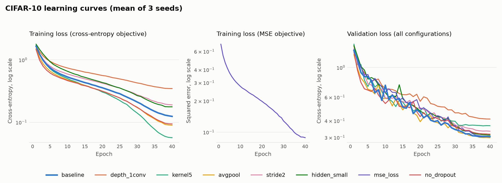
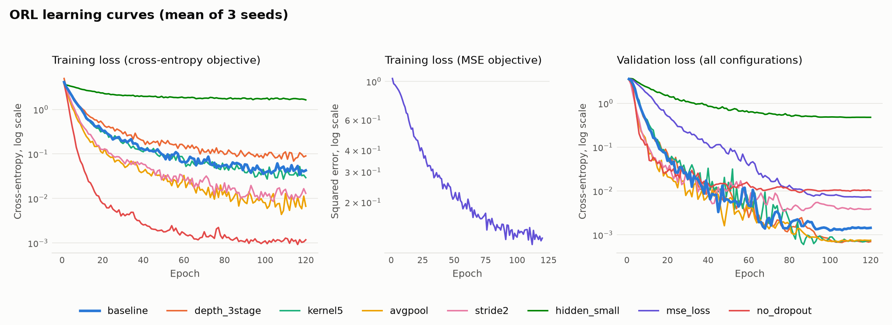
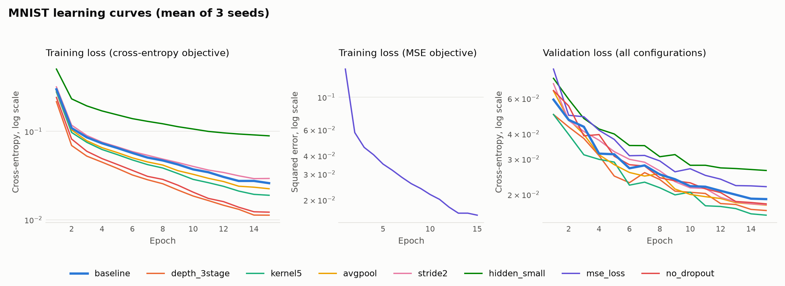

# Stage 3 experiment summary

Generated from the saved runs by `run_stage3.py summarize`. Values are mean ± sample standard deviation over finished seeds.

- Formal runs: 72 ({'evaluated': 72})
- Unfinished runs: none
- Devices: cuda (NVIDIA RTX PRO 4500 Blackwell Server Edition)
- Summed training time: 1.43 hours
- Checkpoint rule: Within a run, keep the epoch with the highest validation accuracy; break ties by the lowest validation cross-entropy, then by the earliest epoch. The test set is never read during training.
- Configuration rule: Within a dataset, pick the configuration with the highest mean selected-checkpoint validation accuracy over seeds; break ties by the lowest mean validation cross-entropy, then by the fewest parameters. The final model is the seed of that configuration ranked first by the checkpoint rule. Test metrics play no part in either choice.

## CIFAR-10

| Config | Changed | Params | Seeds | Val acc % | Test acc % | Precision (macro) % | Recall (macro) % | F1 (macro) % | F1 (weighted) % | Train s |
|---|---|---:|---:|---:|---:|---:|---:|---:|---:|---:|
| baseline | none | 814,570 | 3/3 | 90.75 ± 0.33 | 89.80 ± 0.22 | 89.81 ± 0.18 | 89.80 ± 0.22 | 89.79 ± 0.20 | 89.79 ± 0.20 | 185 |
| depth_1conv | depth | 620,586 | 3/3 | 85.99 ± 0.18 | 85.81 ± 0.27 | 85.76 ± 0.28 | 85.81 ± 0.27 | 85.76 ± 0.28 | 85.76 ± 0.28 | 133 |
| kernel5 | kernel_size | 1,324,010 | 3/3 | 90.45 ± 0.28 | 89.75 ± 0.11 | 89.73 ± 0.07 | 89.75 ± 0.11 | 89.73 ± 0.08 | 89.73 ± 0.08 | 190 |
| avgpool **(selected)** | pooling | 814,570 | 3/3 | 91.29 ± 0.26 | 90.57 ± 0.19 | 90.56 ± 0.18 | 90.57 ± 0.19 | 90.55 ± 0.19 | 90.55 ± 0.19 | 196 |
| stride2 | stride | 814,570 | 3/3 | 89.33 ± 0.48 | 88.91 ± 0.17 | 88.86 ± 0.15 | 88.91 ± 0.17 | 88.87 ± 0.16 | 88.87 ± 0.16 | 191 |
| hidden_small | hidden_dim | 419,242 | 3/3 | 90.59 ± 0.34 | 89.81 ± 0.30 | 89.79 ± 0.28 | 89.81 ± 0.30 | 89.78 ± 0.31 | 89.78 ± 0.31 | 191 |
| mse_loss | loss | 814,570 | 3/3 | 90.03 ± 0.18 | 89.65 ± 0.14 | 89.63 ± 0.15 | 89.65 ± 0.14 | 89.63 ± 0.14 | 89.63 ± 0.14 | 168 |
| no_dropout | dropout | 814,570 | 3/3 | 90.68 ± 0.39 | 89.85 ± 0.41 | 89.85 ± 0.38 | 89.85 ± 0.41 | 89.84 ± 0.40 | 89.84 ± 0.40 | 147 |

Selected by validation: `avgpool`. Final model: seed 2026, test accuracy 90.54%. Reference accuracy above 70%: reached.

## ORL

| Config | Changed | Params | Seeds | Val acc % | Test acc % | Precision (macro) % | Recall (macro) % | F1 (macro) % | F1 (weighted) % | Train s |
|---|---|---:|---:|---:|---:|---:|---:|---:|---:|---:|
| baseline | none | 1,254,808 | 3/3 | 100.00 ± 0.00 | 96.67 ± 1.44 | 95.00 ± 2.17 | 96.67 ± 1.44 | 95.56 ± 1.92 | 95.56 ± 1.92 | 15 |
| depth_3stage | depth | 2,557,080 | 3/3 | 100.00 ± 0.00 | 95.83 ± 1.44 | 93.75 ± 2.17 | 95.83 ± 1.44 | 94.44 ± 1.92 | 94.44 ± 1.92 | 15 |
| kernel5 **(selected)** | kernel_size | 1,427,096 | 3/3 | 100.00 ± 0.00 | 97.50 ± 2.50 | 96.25 ± 3.75 | 97.50 ± 2.50 | 96.67 ± 3.33 | 96.67 ± 3.33 | 15 |
| avgpool | pooling | 1,254,808 | 3/3 | 100.00 ± 0.00 | 97.50 ± 2.50 | 96.25 ± 3.75 | 97.50 ± 2.50 | 96.67 ± 3.33 | 96.67 ± 3.33 | 9 |
| stride2 | stride | 1,484,184 | 3/3 | 100.00 ± 0.00 | 98.33 ± 1.44 | 97.50 ± 2.17 | 98.33 ± 1.44 | 97.78 ± 1.92 | 97.78 ± 1.92 | 7 |
| hidden_small | hidden_dim | 386,776 | 3/3 | 98.33 ± 1.44 | 93.33 ± 2.89 | 90.42 ± 3.61 | 93.33 ± 2.89 | 91.39 ± 3.37 | 91.39 ± 3.37 | 7 |
| mse_loss | loss | 1,254,808 | 3/3 | 100.00 ± 0.00 | 99.17 ± 1.44 | 98.75 ± 2.17 | 99.17 ± 1.44 | 98.89 ± 1.92 | 98.89 ± 1.92 | 8 |
| no_dropout | dropout | 1,254,808 | 3/3 | 100.00 ± 0.00 | 95.83 ± 1.44 | 93.75 ± 2.17 | 95.83 ± 1.44 | 94.44 ± 1.92 | 94.44 ± 1.92 | 9 |

Selected by validation: `kernel5`. Final model: seed 2026, test accuracy 95.00%. Reference accuracy above 95%: NOT reached.

## MNIST

| Config | Changed | Params | Seeds | Val acc % | Test acc % | Precision (macro) % | Recall (macro) % | F1 (macro) % | F1 (weighted) % | Train s |
|---|---|---:|---:|---:|---:|---:|---:|---:|---:|---:|
| baseline | none | 421,738 | 3/3 | 99.47 ± 0.04 | 99.38 ± 0.04 | 99.38 ± 0.04 | 99.37 ± 0.03 | 99.37 ± 0.04 | 99.38 ± 0.04 | 20 |
| depth_3stage | depth | 241,770 | 3/3 | 99.53 ± 0.01 | 99.56 ± 0.03 | 99.56 ± 0.02 | 99.55 ± 0.03 | 99.55 ± 0.03 | 99.56 ± 0.03 | 27 |
| kernel5 **(selected)** | kernel_size | 455,018 | 3/3 | 99.58 ± 0.11 | 99.56 ± 0.01 | 99.57 ± 0.01 | 99.55 ± 0.01 | 99.56 ± 0.01 | 99.56 ± 0.01 | 33 |
| avgpool | pooling | 421,738 | 3/3 | 99.54 ± 0.05 | 99.47 ± 0.02 | 99.47 ± 0.02 | 99.47 ± 0.02 | 99.47 ± 0.02 | 99.47 ± 0.02 | 32 |
| stride2 | stride | 421,738 | 3/3 | 99.47 ± 0.06 | 99.36 ± 0.06 | 99.36 ± 0.06 | 99.35 ± 0.05 | 99.35 ± 0.06 | 99.36 ± 0.06 | 27 |
| hidden_small | hidden_dim | 119,626 | 3/3 | 99.21 ± 0.09 | 99.22 ± 0.07 | 99.22 ± 0.07 | 99.21 ± 0.07 | 99.21 ± 0.07 | 99.22 ± 0.07 | 32 |
| mse_loss | loss | 421,738 | 3/3 | 99.42 ± 0.00 | 99.32 ± 0.10 | 99.31 ± 0.11 | 99.31 ± 0.10 | 99.31 ± 0.10 | 99.32 ± 0.10 | 33 |
| no_dropout | dropout | 421,738 | 3/3 | 99.51 ± 0.01 | 99.36 ± 0.02 | 99.36 ± 0.02 | 99.35 ± 0.02 | 99.36 ± 0.02 | 99.36 ± 0.02 | 28 |

Selected by validation: `kernel5`. Final model: seed 2027, test accuracy 99.55%. Reference accuracy above 95%: reached.
